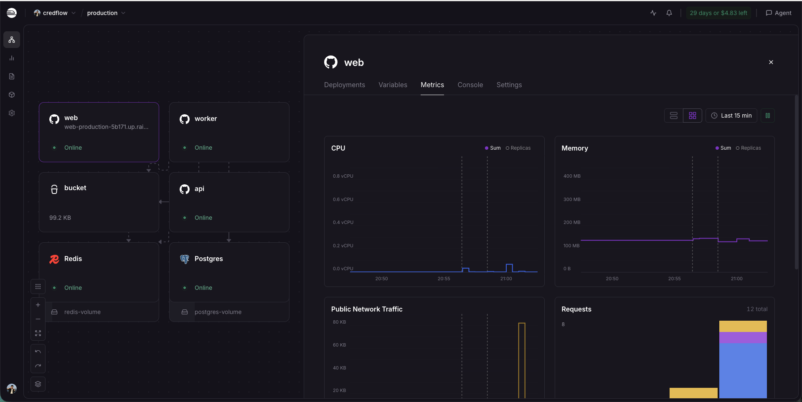
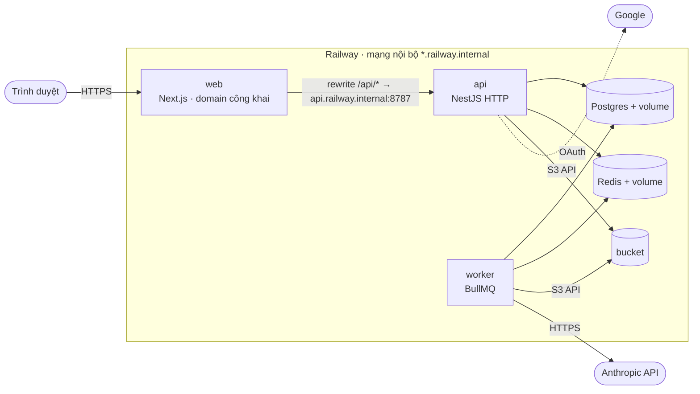
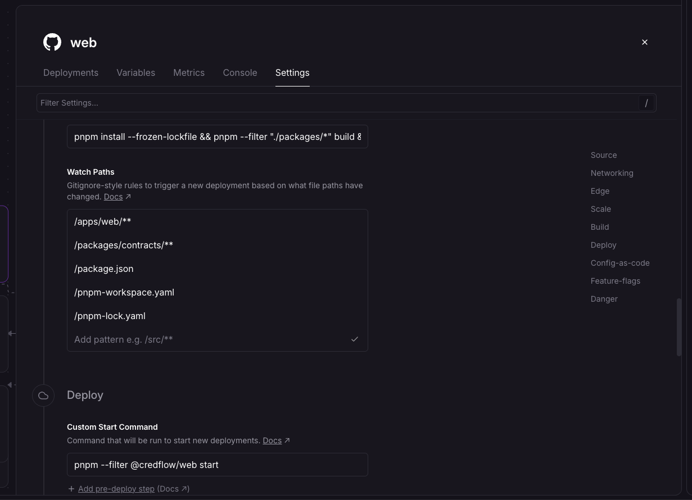
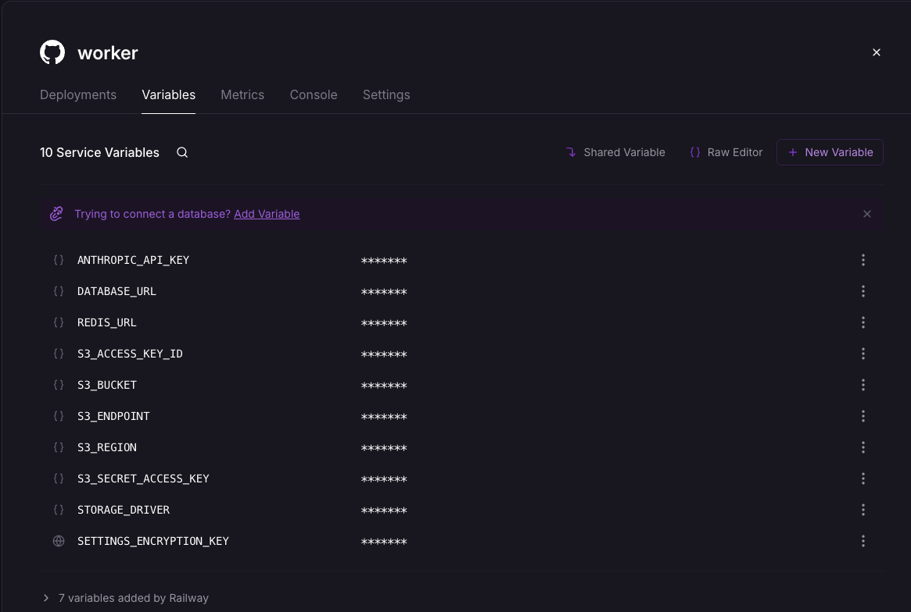

# Deploy CredFlow trên Railway

Tài liệu vận hành: production đang chạy thế nào, deploy ra sao, lỗi hay gặp. Lý do chọn Railway ở ADR 0013; so sánh các lựa chọn ở `docs/research/deploy-options.md`.

- **URL công khai:** https://web-production-5b171.up.railway.app
- **Project:** `credflow`, environment `production`, region Southeast Asia (Singapore)
- **Ai thao tác:** Liam (dashboard Railway, `railway` CLI). Claude không giữ tài khoản Railway.



## Sơ đồ



- Chỉ `web` có domain. Trình duyệt chỉ nói chuyện với `web`; `/api/*` được Next chuyển sang `api` qua mạng nội bộ, nên cookie session cùng domain (ADR 0004).
- `api` nhận upload, ghi file vào bucket, đẩy job vào Redis. `worker` lấy job, đọc file từ bucket, gọi Claude, chạy rule, ghi kết quả vào Postgres.
- Bucket thay cho volume vì volume chỉ gắn một service; `worker` cần đọc file `api` ghi (plan 33).

## Các service

| Service | Build | Start | Pre-deploy | Healthcheck |
| --- | --- | --- | --- | --- |
| `web` | `pnpm install --frozen-lockfile && pnpm --filter "./packages/*" build && pnpm --filter @credflow/web build` | `pnpm --filter @credflow/web start` | – | – |
| `api` | như trên, `--filter @credflow/api build` | `pnpm --filter @credflow/api start` | `pnpm --filter @credflow/api db:migrate` | `/ready` |
| `worker` | như `api` | `pnpm --filter @credflow/api start:worker` | – | – |
| `Postgres`, `Redis` | template Railway | | | |
| `bucket` | Railway Bucket (S3) | | | |

Build bằng Railpack từ gốc monorepo, không Dockerfile. Migration chạy ở pre-deploy của `api`: lỗi thì deploy dừng, bản cũ chạy tiếp. Healthcheck `/ready` chỉ xanh khi nối được Postgres và Redis, nên Railway chỉ chuyển traffic sang bản mới khi bản mới khoẻ.

### Watch paths
Commit chỉ kích deploy service nào có file khớp. Bốn nhóm cần có: code của app, package workspace nó import, file cài đặt chung, file app đọc lúc chạy.

| Service | Watch paths |
| --- | --- |
| `web` | `/apps/web/**`, `/packages/contracts/**`, `/package.json`, `/pnpm-workspace.yaml`, `/pnpm-lock.yaml` |
| `api`, `worker` | `/apps/api/**`, `/config/rules/**`, `/packages/**`, `/pnpm-workspace.yaml`, `/pnpm-lock.yaml`, `/package.json` |



Dùng `**` để khớp cả thư mục con (`/apps/web/*` chỉ khớp file ngay trong `apps/web/`). Không có khoảng trắng đầu dòng.

## Biến môi trường

Chỉ ghi tên; giá trị nằm trên Railway. Giá trị dùng chung lấy bằng reference variable, tên service phân biệt hoa thường (`${{bucket.…}}`, không phải `${{Bucket.…}}`).

| Biến | `web` | `api` | `worker` | Ghi chú |
| --- | :-: | :-: | :-: | --- |
| `API_URL` | ✓ | | | `http://api.railway.internal:8787`, đọc lúc **build** |
| `DATABASE_URL` | | ✓ | ✓ | `${{Postgres.DATABASE_URL}}`, không dán chuỗi rõ |
| `REDIS_URL` | | ✓ | ✓ | `${{Redis.REDIS_URL}}?family=0` (mạng nội bộ IPv6) |
| `API_HOST` | | ✓ | | `::` |
| `STORAGE_DRIVER`, `S3_*` | | ✓ | ✓ | `s3`; `S3_*` lấy từ `${{bucket.…}}` |
| `ANTHROPIC_API_KEY` | | | ✓ | khoá hệ thống |
| `SETTINGS_ENCRYPTION_KEY` | | ✓ | ✓ | `${{shared.SETTINGS_ENCRYPTION_KEY}}`, hai bên phải cùng giá trị (plan 35) |
| `GOOGLE_CLIENT_ID`, `GOOGLE_CLIENT_SECRET`, `GOOGLE_REDIRECT_URL`, `OAUTH_STATE_SECRET` | | ✓ | | đủ cả 4 hoặc không đặt (plan 36) |
| `LOGIN_RATE_LIMIT`, `UPLOAD_RATE_PER_HOUR`, `DAILY_UPLOAD_CAP`, `SIGNUP_DAILY_CAP` | | ✓ | | tuỳ chọn, bỏ trống thì dùng mặc định (plan 34, 36) |
| `FILE_RETENTION_DAYS` | | | ✓ | tuỳ chọn, mặc định 3 ngày; job xoá file chạy ở `worker` |

`worker` hiện có 10 biến: `ANTHROPIC_API_KEY`, `DATABASE_URL`, `REDIS_URL`, `STORAGE_DRIVER`, 5 biến `S3_*` (`ACCESS_KEY_ID`, `BUCKET`, `ENDPOINT`, `REGION`, `SECRET_ACCESS_KEY`) và `SETTINGS_ENCRYPTION_KEY` (biểu tượng quả địa cầu = shared variable). Railway tự thêm 7 biến `RAILWAY_*`.



Đổi biến xong phải bấm **Deploy** trên thanh tím: Railway gom thay đổi lại, chưa bấm thì chưa có hiệu lực. App kiểm env lúc khởi động (fail-fast), sai thì log nêu tên biến và bản cũ chạy tiếp.

## Quy trình deploy

1. PR merge vào `main` → GitHub tạo commit `Merge pull request #…`.
2. **Wait for CI**: Railway chờ GitHub Actions trên commit đó xanh.
3. Service nào có file khớp watch path thì build → pre-deploy → healthcheck → nhận traffic.
4. **Kiểm sau mỗi lần merge:** tab Deployments của từng service bị chạm, bản **ACTIVE** phải là commit vừa merge.

| Muốn | Dùng |
| --- | --- |
| Chạy code mới nhất trên `main` (bản tự động bị lỡ) | ⌘K → **Deploy Latest Commit** |
| Khởi động lại, thử lại khi lỗi hạ tầng, áp biến | ⋮ → **Redeploy** (chạy lại đúng commit cũ) |
| Quay về bản trước | ⋮ trên bản cũ → **Redeploy** |

## Việc tay thường gặp

```bash
railway login && railway link           # chọn project credflow, environment production
railway ssh --service api               # vào container api
export PATH=/mise/shims:$PATH           # trong container: pnpm nằm ở đây
pnpm --filter @credflow/api db:seed     # seed, cần SEED_PASSWORD (≥ 12 ký tự)
pnpm --filter @credflow/api db:reset-demo-password   # quên mật khẩu tài khoản demo (plan 34)
```
Gõ mật khẩu bằng `read -s` hoặc `\password` trong psql, không để lại trong lịch sử shell, chat hay screenshot.

## Sự cố đã gặp

| Triệu chứng | Nguyên nhân | Sửa |
| --- | --- | --- |
| `getaddrinfo ENOTFOUND  ::` | `API_HOST=" ::"` có khoảng trắng | xoá khoảng trắng; app giờ chặn từ lúc khởi động |
| Biến bucket rỗng | `${{Bucket.…}}` trong khi service tên `bucket` | sửa đúng tên |
| Lỗi build Next về `API_URL` | giá trị có khoảng trắng đầu | sửa giá trị, `next.config.mjs` đã kiểm |
| Mật khẩu DB lộ trong screenshot | dán `DATABASE_URL` dạng chuỗi rõ | đổi mật khẩu trong DB trước (`\password`), rồi dùng reference variable |
| `pnpm: command not found` trong `railway ssh` | PATH của shell ssh thiếu mise | `export PATH=/mise/shims:$PATH` |
| `web` vẫn chạy code cũ sau merge #58 | bản tự động không lên (build lỗi hạ tầng), sau đó Redeploy chạy lại commit #56 | **Deploy Latest Commit** |
| "Railpack build driver could not be downloaded" | lỗi hạ tầng Railway, chưa đụng tới code | đợi vài phút rồi chạy lại |

## Chưa làm

- Lên gói Hobby + Usage Limits (soft khoảng $10, hard khoảng $20); trần chi tiêu Anthropic.
- Backup Postgres và thử khôi phục.
- Thông báo khi deploy hỏng; giám sát, cảnh báo.
- Đưa cấu hình service vào code (`.railway/railway.ts`).
- Postgres dev 16 / Railway 18.6; Node dev 24 / Railway 22.
